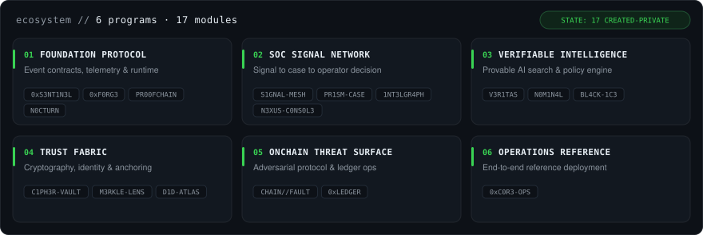

  

  

> **0xR3TRO builds verifiable systems for adversarial digital environments.**  
> Cryptography, identity &amp; on-chain data → signal correlation &amp; evidence analysis → controlled operational action.  
> *AI is a layer, not the goal. Blockchain is used only where it earns trust. Every module proves measurable impact and contains operational risk.*

  

<code>▸ MODULE REGISTRY &amp; LIFECYCLE (17 modules · Created-private)</code>

 

**Lifecycle:** `Planned` → **`Created-private`** → `Bootstrapped` → `Vertical-slice` → `Internal-verified` → `Public-release` → `Maintained/Archived`  
*Modules are linked here only after they reach **Public-release**.*

| Module | Function | State |
| :--- | :--- | :--- |
| `0xS3NT1N3L` | Event provenance and telemetry fabric | `Created-private` |
| `0xF0RG3` | Policy-bound workflow execution runtime | `Created-private` |
| `PR00FCHAIN` | Software and model assurance gate | `Created-private` |
| `N0CTURN` | Operational observability and model telemetry | `Created-private` |
| `S1GNAL-MESH` | Alert correlation and risk fusion | `Created-private` |
| `PR1SM-CASE` | Evidence-first incident workspace | `Created-private` |
| `1NT3LGR4PH` | Provenance-aware threat intelligence graph | `Created-private` |
| `N3XUS-C0NS0L3` | Evidence-first analyst control surface | `Created-private` |
| `V3R1TAS` | Citation-bound technical evidence search | `Created-private` |
| `N0M1N4L` | Abstaining decision and policy engine | `Created-private` |
| `BL4CK-1C3` | Adversarial regression laboratory | `Created-private` |
| `C1PH3R-VAULT` | Sealed evidence and key lifecycle | `Created-private` |
| `M3RKLE-LENS` | Tamper-evident evidence anchoring | `Created-private` |
| `D1D-ATLAS` | Decentralized identity and authorization laboratory | `Created-private` |
| `CHAIN//FAULT` | Smart-contract and protocol security workbench | `Created-private` |
| `0xLEDGER` | On-chain transaction intelligence | `Created-private` |
| `0xC0R3-OPS` | Secure operations reference deployment | `Created-private` |

---

  <a href="./ABOUT-ME.md"><code>ABOUT</code></a> ·
  <a href="./SKILL.md"><code>SKILLS</code></a> ·
  <a href="./VISION.md"><code>VISION</code></a> ·
  <a href="./WORK-EXPERIENCE.md"><code>EXPERIENCE</code></a> ·
  <a href="./CONTACT.md"><code>CONTACT</code></a>

